# مدل مفهومی و نمودار موجودیت‌ـ‌رابطه (ERD) — NIGC-DTG

**مکمل:** `data-dictionary.md` (فیلدها) و `architecture.md` (لایه داده). کاردینالیتی‌ها از الزامات §۷-§۱۷ پرامپت و گام‌های سند مرجع استخراج شده‌اند.

---

## ۱. روابط موجودیت‌ها (توصیف متنی)

### ۱.۱ بلوک هویت و سازمان
1. **User ↔ Role (چند‌به‌چند از طریق UserRole):** هر کاربر می‌تواند چند نقش داشته باشد؛ هر UserRole می‌تواند به یک OrgUnit محدود شود (محدوده سازمانی نقش — ABAC §۸).
2. **OrgUnit خودارجاع (Parent-Child):** سلسله‌مراتب شرکت ملی گاز / ستادها / شرکت‌های تابعه (§۸)؛ تغییر ساختار با validFrom/validTo بدون تخریب تاریخچه (قاعده ۲٫۵.۶).
3. **OrgUnit → User (۴ نقش مرجع):** manager، deputy، رابط تحول دیجیتال (dtCoordinator)، مالک داده (dataOwner)، متولی داده (dataCustodian) — مبنای گزارش پوشش گام ۱۱.
4. **User → Session (1:N):** هر کاربر چند نشست فعال می‌تواند داشته باشد؛ غیرفعال‌سازی کاربر همه Sessionها را ابطال می‌کند (§۸ قاعده ۷).
5. **User → AuditLog (1:N، اختیاری):** عملیات حساس مدیر سامانه هم ثبت می‌شود (§۸ قاعده ۸).

### ۱.۲ بلوک اقدامات
6. **Action خودارجاع (وابستگی):** `dependencyActionIds` — فقط وابستگی‌های صریح سند (مثل گام ۲۷→۱۹)؛ سایر اقدامات موازی اجرا می‌شوند (قاعده ۲٫۵.۱).
7. **Action → ActionUpdate (1:N):** تاریخچه وضعیت/مهلت/انتساب/نظر (§۷)؛ سررسید قبلی در ActionUpdate.m oldValue ماندگار است.
8. **Action → OrgUnit / User:** owner (مسئول اجرا)، followup (مسئول پیگیری دبیرخانه)، approver (مسئول تأیید)؛ partnerUnits به‌صورت JSON.
9. **Action → FileAsset (1:N):** پیوست‌ها و شواهد انجام (§۷).
10. **Action → Deviation (1:N):** هر انحراف از مهلت الزاماً دارای علت/مسئول/شدت/اقدام جبرانی (قاعده ۲٫۵.۳).

### ۱.۳ بلوک اسناد
11. **Document → DocumentVersion (1:N):** نسخه‌بندی و تفاوت نسخه‌ها (§۹)؛ سند مصوب بدون نسخه جدید تغییر بی‌ردپا نمی‌کند.
12. **DocumentVersion → FileAsset (N:1 اختیاری):** فایل هر نسخه.
13. **Document ↔ Action/Project/Meeting (N:N مفهومی):** از فیلدهای JSON `related*Ids` (§۹: اتصال سند به اقدام، پروژه، جلسه، مصوبه، واحد).
14. **Document → User (owner، drafted/reviewed/approved در نسخه):** ثبت گردش تدوین/بررسی/تأیید (§۹).

### ۱.۴ بلوک سبد پروژه‌ها
15. **Project → OrgUnit / User:** sponsoringOrgUnit، businessOwner، projectManager (§۱۰).
16. **Project → ProjectScore (1:N):** هر ارزیابی جدا با نسخه مدل، ارزیاب و تاریخ (گام ۲۳، محور ۶-۳)؛ مقادیر نهایی قابل ممیزی.
17. **Project → Decision (اختیاری N:1):** مصوبه تصویب — تصویب نهایی سبد فقط شورا (گام ۲۵).
18. **Project ↔ Document / Risk / BudgetItem (N:N مفهومی):** اسناد پروژه، ریسک‌ها، نیازهای مالی (§۱۰، گام ۷، ۲۹).

### ۱.۵ بلوک حاکمیت داده و AI
19. **DataDomain → OrgUnit / User:** مالک/متولی + تولیدکننده/مصرف‌کننده/نگهدارنده (§۱۱)؛ تغییر مالکیت تاریخچه قبلی را نمی‌بُرد.
20. **DigitalStatusEntry → OrgUnit (N:1):** هر واحد چند رکورد سامانه/پایگاه داده/کاربرد AI (گام ۱۲)؛ خروجی AI_Applicationهای شناسایی‌شده به دفتر ثبت می‌رود.
21. **AiApplication → OrgUnit / User / Document:** واحد مالک، مسئول کسب‌وکار، مستند مجوز/ارزیابی (§۱۲)؛ قاعده «بدون ثبت و ارزیابی، بهره‌برداری ممنوع» با وضعیت + ارزیابی کنترل می‌شود (قاعده ۲٫۵.۷).

### ۱.۶ بلوک شاخص/ریسک
22. **Kpi → KpiMeasurement (1:N):** دوره‌ای؛ یکی از اندازه‌گیری‌ها می‌تواند isBaseline باشد (گام ۲۶).
23. **Risk → Action/Project/Budget (پلی‌مورفیک):** relatedEntityType/Id (§۱۳).
24. **Deviation → Action/Report/Project (پلی‌مورفیک)** با امکان Escalated به شورا (مرجع تفسیر — بخش ۱ سند).

### ۱.۷ بلوک جلسات و گزارش
25. **Meeting → Decision (1:N):** هر مصوبه مسئول و مهلت پیگیری دارد (§۱۴).
26. **Meeting ↔ Action/Project/Risk/Document:** موضوعات دستور جلسه متصل‌اند (§۱۴)؛ بسته جلسه نخست = گام ۹.
27. **Decision → Project/Action:** وضعیت اجرای مصوبه پایش می‌شود (فهرست باز/معوق/اجرا‌شده).
28. **Report مستقل با periodStart/End و dueDate (قاعده ۱۵ روزه فصلی — گام ۳۱)**؛ generatedBy مشخص می‌کند پیش‌نویس AI است یا سیستمی.

### ۱.۸ پشتیبان‌ها
29. **User → Notification (1:N)** با انواع §۱۷.
30. **FileAsset پلی‌مورفیک به Action/Document/Meeting/Project** (پیوست هر موجودیت).
31. **Setting / BaselineChange:** BaselineChange قبل/بعد و تأییدکننده دارد و از Setting جدا است تا تاریخچه تغییر مبنا مستقل بماند (§۲.۲).
32. **AiChatLog → User (1:N):** مصرف مدل، ارجاع‌های بازیابی، بازخورد (§۱۵).
33. **KnowledgeArticle → Action (اختیاری):** راهنماهای متصل به گام ۲ و پشتیبانی گام ۳۵.

---

## ۲. نمودار ERD (Mermaid)

```mermaid
erDiagram
    %% ---- هویت و سازمان ----
    USER ||--o{ USER_ROLE : "دارد"
    USER ||--o{ SESSION : "باز می‌کند"
    USER ||--o{ AUDIT_LOG : "ثبت می‌کند"
    USER ||--o{ NOTIFICATION : "دریافت می‌کند"
    USER ||--o{ AI_CHAT_LOG : "گفت‌وگو می‌کند"
    ROLE ||--o{ USER_ROLE : "به کاربران"
    ORG_UNIT ||--o{ USER_ROLE : "محدوده نقش"
    ORG_UNIT |o--o| ORG_UNIT : "والد-فرزند"

    %% ---- اقدامات ----
    ORG_UNIT ||--o{ ACTION : "واحد همکار/مسئول"
    USER ||--o{ ACTION : "مسئول اجرا/پیگیری/تأیید"
    ACTION ||--o{ ACTION_UPDATE : "تاریخچه"
    ACTION ||--o{ DEVIATION : "انحرافات"
    ACTION ||--o{ FILE_ASSET : "پیوست‌ها"
    ACTION |o--o{ ACTION : "وابستگی صریح"

    %% ---- اسناد ----
    USER ||--o{ DOCUMENT : "مالک سند"
    DOCUMENT ||--o{ DOCUMENT_VERSION : "نسخه‌ها"
    DOCUMENT_VERSION |o--o| FILE_ASSET : "فایل نسخه"

    %% ---- سبد پروژه‌ها ----
    ORG_UNIT ||--o{ PROJECT : "پیشنهاددهنده"
    USER ||--o{ PROJECT : "مالک کسب‌وکار/مدیر پروژه"
    PROJECT ||--o{ PROJECT_SCORE : "ارزیابی‌ها ۴۰/۲۰/۲۰/۲۰"
    DECISION |o--o{ PROJECT : "مصوبه تصویب"
    PROJECT ||--o{ FILE_ASSET : "مستندات"

    %% ---- حاکمیت داده و AI ----
    ORG_UNIT ||--o{ DATA_DOMAIN : "تولید/مصرف"
    USER ||--o{ DATA_DOMAIN : "مالک/متولی داده"
    ORG_UNIT ||--o{ DIGITAL_STATUS_ENTRY : "وضعیت موجود"
    ORG_UNIT ||--o{ AI_APPLICATION : "واحد مالک"
    DOCUMENT |o--o{ AI_APPLICATION : "مستند مجوز"

    %% ---- شاخص/ریسک ----
    KPI ||--o{ KPI_MEASUREMENT : "اندازه‌گیری‌ها"
    USER ||--o{ KPI : "متولی شاخص"
    USER ||--o{ RISK : "مالک ریسک"
    USER ||--o{ DEVIATION : "مسئول انحراف"

    %% ---- جلسات/بودجه/گزارش ----
    MEETING ||--o{ DECISION : "مصوبات"
    MEETING |o--o{ FILE_ASSET : "مستندات پیش از جلسه"
    BUDGET_ITEM |o--o| PROJECT : "پروژه مرتبط"
    BUDGET_ITEM |o--o| ACTION : "اقدام مرتبط (گام ۲۹)"
    REPORT }o--|| SETTING : "مبنای تقویم/مبنا"

    %% ---- تنظیمات ----
    SETTING ||--o{ BASELINE_CHANGE : "تاریخچه تغییر مبنا"
```

---

## ۳. یادداشت‌های مدل

| موضوع | تصمیم مدل | منبع |
|---|---|---|
| روابط پلی‌مورفیک (Risk/Deviation/FileAsset) | به‌جای FK سخت، `relatedEntityType + relatedEntityId`؛ ساده‌سازی عمدی برای انعطاف گردش کار حاکمیتی | §۱۳، §۹ |
| refStep یکتا | فقط ۳۷ گام سند؛ اقدامات مصوب جدید refStep=null | §۲.۱، قاعده ۲٫۵.۸ |
| AuditLog بدون رابطه FK سخت | userId نرم‌ارجاع تا حذف/بایگانی کاربر تاریخچه را نشکند | §۱۸ |
| JSON vs جدول جدا | موارد کم‌کوئری (تیم، شواهد، agenda) JSON؛ موارد تحلیل‌پذیر (Score، Measurement، Decision) جدول کامل — مهاجرت آسان به PostgreSQL | §۴ |
| مهلت‌ها مشتق‌شده | dueDate ذخیره می‌شود ولی همیشه از baseline+dueDays بازمحاسبه و اعتبارسنجی می‌شود | §۲.۲ |
| تفکیک ممیزی | AuditLog و AiChatLog جدا از داده عملیاتی، فقط append | §۱۸، §۱۵ |
